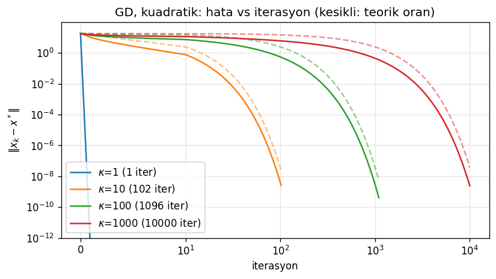
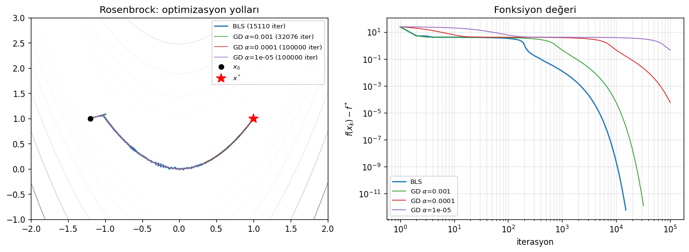
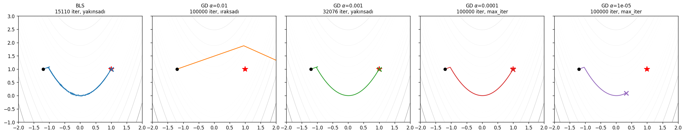
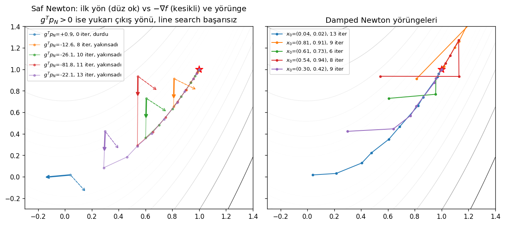
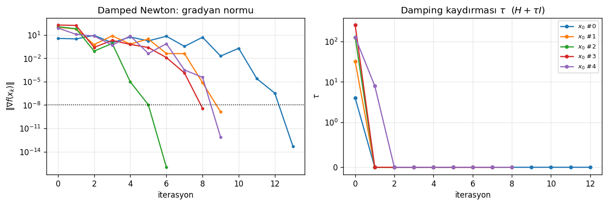
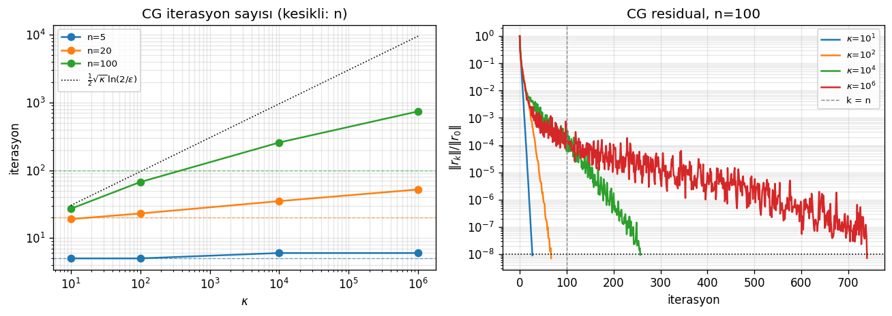

# optlib

A small numerical optimization library written from scratch in NumPy, built alongside a series of notebooks that put each algorithm under the microscope: does it converge, how fast, and *why* — compared against what the theory predicts.

No `scipy.optimize`, no autodiff: every gradient, Hessian, line search and update rule is implemented by hand and checked numerically.

> **Status:** Modules 1–2 (first-order methods, line search, Newton, linear CG) are complete. BFGS is in progress; later modules (constraints, sparse/proximal, stochastic) are on the roadmap.

---

## Highlights

- **Theory vs. experiment.** Gradient descent's measured linear convergence rate on quadratics matches the bound $r = \frac{\kappa-1}{\kappa+1}$ to within 1% for $\kappa = 10, 100, 1000$.
- **Line search pays off.** On Rosenbrock, Armijo backtracking converges in about half the iterations of the best hand-tuned fixed step. Too large a step blows up in 6 iterations; too small a step fails to converge within 100k.
- **Newton, safely.** With an indefinite Hessian, pure Newton can produce an *ascent* direction and stall. Shifting the Hessian ($H + \tau I$) fixes that: the shift is only needed for the first one or two iterations, after which the method recovers quadratic convergence.
- **CG in floating point.** Linear CG finishes in about $n$ steps on well-conditioned systems. At $\kappa = 10^6$ loss of orthogonality pushes it far past the textbook $n$-step guarantee, while staying under the $\sqrt{\kappa}$ bound.

---

## Module 1 — First-order methods & line search

Notebook: [`notebooks/01-basics.ipynb`](notebooks/01-basics.ipynb)

### 1.1–1.2 Test problems and gradient verification
`Quadratic`, `Rosenbrock2d`, `RosenbrockNd` and `Himmelblau` each provide `f(x)`, `grad(x)` and `hess(x)`. Every analytic gradient is checked against central finite differences with `optlib.utils.grad_check`.

### 1.3 Gradient descent and the condition number
GD with the optimal fixed step $\alpha = 2/(\lambda_{\max}+\lambda_{\min})$ on $1024$-dimensional quadratics with a controlled condition number $\kappa$:

| $\kappa$ | Iterations to $\|\nabla f\| < 10^{-8}$ | Theoretical rate $r$ | Measured rate |
|---:|---:|---:|---:|
| 1 | 1 | 0 | — |
| 10 | 102 | 0.8182 | 0.8109 |
| 100 | 1 096 | 0.9802 | 0.9794 |
| 1000 | > 10 000 (not converged) | 0.9980 | 0.9979 |



The dashed lines are the theoretical bound $\|x_k - x^*\| \le r^k \|x_0 - x^*\|$; every run stays below its bound, and the required iterations grow roughly linearly with $\kappa$.

### 1.4 Backtracking (Armijo) line search vs. fixed step
Rosenbrock function from the classic start $x_0 = (-1.2,\ 1)$:

| Method | Iterations | Result |
|---|---:|---|
| **Backtracking line search** | **15 110** | converged |
| GD, $\alpha = 10^{-2}$ | 6 | diverged (overflow) |
| GD, $\alpha = 10^{-3}$ | 32 076 | converged |
| GD, $\alpha = 10^{-4}$ | 100 000 | not converged |
| GD, $\alpha = 10^{-5}$ | 100 000 | not converged |




All methods follow the same curved valley. Line search adapts the step size automatically, without tuning, but on this problem it settles at $\alpha \approx 2$–$4 \times 10^{-3}$. That is the hard limit of steepest descent on a narrow valley, and the motivation for second-order methods.

---

## Module 2 — Second-order methods & conjugate gradients

Notebook: [`notebooks/02-second-deriv.ipynb`](notebooks/02-second-deriv.ipynb)

### 2.1–2.2 Newton's method and Hessian damping
Newton directions are computed through a Cholesky factorization. When the Hessian is not positive definite, the damped variant shifts it to $H + \tau I$, doubling $\tau$ until the factorization succeeds.

The experiment starts from 5 random points where the Rosenbrock Hessian is **indefinite**:

| $x_0$ | $g^\top p_N$ | Pure Newton | Damped Newton | $\tau$ used |
|---|---:|---|---|---|
| (0.04, 0.02) | **+0.89** | fails (ascent direction) | 13 iter | 8 |
| (0.81, 0.91) | −12.6 | 8 iter | 9 iter | 64 |
| (0.61, 0.73) | −26.1 | 10 iter | 6 iter | 256 |
| (0.54, 0.94) | −81.8 | 11 iter | 8 iter | 512 |
| (0.30, 0.42) | −22.1 | 13 iter | 9 iter | 256 → 16 |




An indefinite Hessian does not guarantee an ascent direction, but it does not guarantee descent either. Damping makes every step a descent step. It switches off ($\tau = 0$) once the iterates reach the convex region, and the final iterations show the characteristic quadratic convergence of the gradient norm.

### 2.3 BFGS
*In progress.*

### 2.4 Linear conjugate gradient
CG on SPD systems $Ax = b$ for $n \in \{5, 20, 100\}$ and $\kappa \in \{10, 10^2, 10^4, 10^6\}$, stopping at $\|r_k\| < 10^{-8}\|r_0\|$:

| $\kappa$ \ $n$ | 5 | 20 | 100 |
|---:|---:|---:|---:|
| $10$ | 5 | 19 | 28 |
| $10^2$ | 5 | 23 | 67 |
| $10^4$ | 6 | 35 | 263 |
| $10^6$ | 6 | 49 | 783 |



In exact arithmetic CG terminates in at most $n$ steps. In floating point that only holds while the problem is well conditioned. For $n = 100$, $\kappa \ge 10^4$ loss of orthogonality between search directions delays convergence well beyond $n$, and the residual becomes visibly noisy, while the iteration count still stays below the $\tfrac{1}{2}\sqrt{\kappa}\ln(2/\epsilon)$ bound.

---

## Usage

```python
import numpy as np
from problems.testfuncs import Rosenbrock2d, Quadratic, make_quadratic
from optlib.second_order import NewtonOptimizer
from optlib.first_order import LinearCG

# Damped Newton with Armijo backtracking
f = Rosenbrock2d(a=1, b=100)
res = NewtonOptimizer(damping=True).minimize(f, x0=np.array([-1.2, 1.0]), tol=1e-8)
print(res.converged, res.n_iter, res.x)   # True 21 [1. 1.]

# Linear CG on an ill-conditioned SPD system
A = make_quadratic(n=100, kappa=1e4)
res = LinearCG().minimize(Quadratic(A), x0=np.ones(100), tol=1e-8)
print(res.converged, res.n_iter)          # True 260
```

Every optimizer returns a `Result` with `x`, `fval`, `n_iter`, `converged` and a `history` dict (`f`, `gradnorm`, `x`, `step`, …), which the notebooks use for all plots.

## Project structure

```
optlib/
  base.py           Problem / Optimizer / Result interfaces
  first_order.py    GD, LinearCG
  line_search.py    Armijo backtracking, BacktrackingLineSearch optimizer
  second_order.py   Newton (+ damping), BFGS (WIP)
  utils.py          finite-difference gradient check, history plots
problems/
  testfuncs.py      Quadratic, Rosenbrock (2D / ND), Himmelblau, make_quadratic
notebooks/
  01-basics.ipynb         Module 1
  02-second-deriv.ipynb   Module 2
figures/                  plots used in this README
```

## Setup

Requires Python ≥ 3.10. With [uv](https://github.com/astral-sh/uv):

```bash
git clone git@github.com:abardakci/optlib.git
cd optlib
uv sync
uv run --with jupyterlab jupyter lab notebooks/
```

Dependencies: NumPy, SciPy (triangular solves only), Matplotlib.

## Roadmap

- [x] Module 1: gradient descent, Armijo backtracking
- [x] Module 2: Newton, damped Newton, linear CG
- [ ] BFGS, Wolfe line search
- [ ] Constrained optimization
- [ ] Sparse / proximal methods
- [ ] Stochastic methods for deep learning
